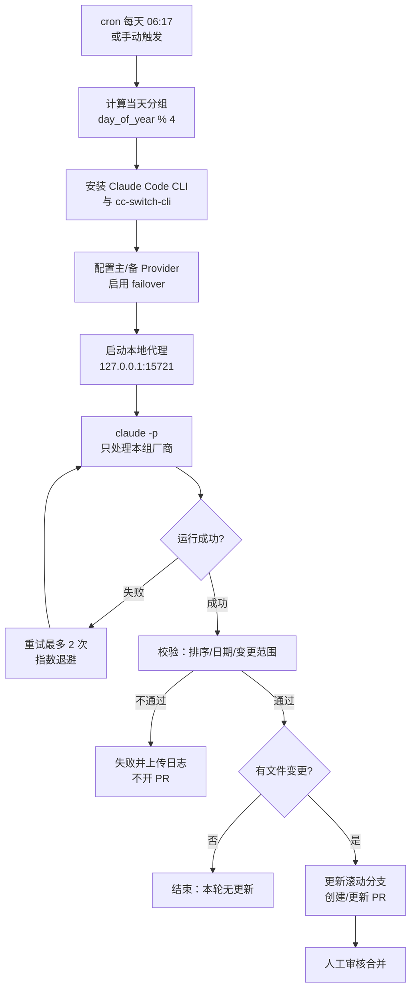

# 定时自动更新方案：GitHub Actions + Claude Code CLI + 第三方 OpenAI 兼容 API

> 状态：设计稿，待评审
> 日期：2026-10-30
> 适用仓库：`ai-model-news`

## 1. 背景与目标

当前维护方式是人工隔几天查看各厂商是否发布新模型，再手动更新公司文档与 README 时间线。目标是把这套流程自动化：

- **定时**：每天由 GitHub Actions 触发
- **轮换**：每天只处理 4～6 家厂商，约 4 天覆盖一轮全量
- **自动检索**：按 CLAUDE.md 的数据源优先级抓取官方文档与 OpenRouter API
- **自动更新**：修改对应厂商 md 与 README 时间线表
- **人工把关**：只开 PR，不直接改 `main`
- **限流容错**：单次 429、上游抖动、单厂商失败都不能让整轮任务白跑

**非目标**：不自动合并 PR、不做全站爬虫、不替代人工判断数据真伪。

## 2. 结论速览

| 问题 | 结论 |
| ---- | ---- |
| GitHub Actions 能否定时跑？ | ✅ 用 `on.schedule`，公开仓库不消耗额度 |
| 能否用第三方 OpenAI Chat 格式 API 驱动 Claude Code？ | ✅ 需要一层本地协议转换代理 |
| ccswitch 有 Linux 版吗？ | ✅ 桌面版有 AppImage/deb/rpm；**CLI 版有 Linux 预编译二进制，适合 CI** |
| 429 容错怎么做？ | 分组隔离 + 多 Provider failover + CLI 内置重试 + 预算上限 + workflow 重试 |

## 3. 为什么需要协议转换

Claude Code 只会向 `ANTHROPIC_BASE_URL` 发送 **Anthropic Messages** 格式请求；而第三方中转提供的是 **OpenAI Chat Completions** 格式。把 `ANTHROPIC_BASE_URL` 直接指向 OpenAI 端点会返回 404/405。

因此需要中间层做协议转换：

```text
Claude Code ──Anthropic Messages──▶ 本地代理 ──OpenAI Chat Completions──▶ 第三方中转
                127.0.0.1:15721
```

### 3.1 CC Switch 的 Linux 支持

两个同名项目容易混淆，CI 场景要用后者：

| 项目 | 形态 | Linux 产物 | 是否适合 Actions |
| ---- | ---- | ---------- | ---------------- |
| `farion1231/cc-switch` | Tauri 桌面 GUI | `.AppImage` / `.deb` / `.rpm`（x86_64、arm64） | ❌ 无显示器，GUI 跑不起来 |
| `SaladDay/cc-switch-cli` | Rust CLI + TUI | `cc-switch-cli-linux-x64-musl.tar.gz` 等预编译二进制 | ✅ 纯命令行，可 headless |

`cc-switch-cli` 对 CI 有用的能力：

- **非交互添加 Provider**（CLI 源码中明确标注 `Add` 为 non-interactive）
- **协议转换代理**：`proxy serve --takeover claude --listen-port 15721`，前台模式全平台可用
- **自动 failover 队列**：主 Provider 429/5xx 时切换备用 Provider
- **健康检查**：`provider stream-check <id>` 可在正式运行前做一次冒烟测试

### 3.2 备选方案对比

| 方案 | 协议转换 | CI 友好度 | 429 容错 | 结论 |
| ---- | -------- | --------- | -------- | ---- |
| **cc-switch-cli 本地代理** | ✅ | ✅ 单二进制 | ✅ 内置 failover 队列 | **采用** |
| claude-code-router (CCR) | ✅ | ✅ npm 安装 | ⚠️ 需自行配置重试 | 备选 |
| LiteLLM Proxy | ✅ `/v1/messages` | ⚠️ Python 依赖较重 | ✅ 重试/fallback 成熟 | 备选 |
| 纯 Node 脚本，不调 LLM | ❌ | ✅ 最稳定 | ✅ | 无法解析非结构化文档，只能做 OpenRouter diff |
| 直接把 OpenAI 端点当 Anthropic 用 | ❌ | — | — | 不可行 |

## 4. 总体架构



## 5. 组件与文件清单

```text
.github/
├── workflows/
│   └── auto-update.yml          # 编排入口
├── auto-update.config.json      # 非敏感项目级参数
└── prompts/
    └── auto-update.md           # 给 Claude 的任务提示词

.claude/
└── settings.json                # 工具权限白名单/黑名单

scripts/
├── vendors.json                 # 厂商分组
├── pick_vendors.js              # 计算当天分组
├── sort_timeline.js             # 已有：时间线排序
└── ci/
    ├── run-claude.sh            # 带退避重试的调用包装
    ├── validate_run.js          # 运行结果校验
    └── build_pr_body.js         # 由报告生成 PR 描述
```

每个组件职责单一，可独立运行验证：

| 组件 | 输入 | 输出 |
| ---- | ---- | ---- |
| `pick_vendors.js` | 日期、`vendors.json` | 当天厂商文件列表 |
| `run-claude.sh` | 提示词、环境变量 | Claude 运行日志、退出码 |
| `validate_run.js` | git diff、运行报告 | 通过/失败 + 原因 |
| `build_pr_body.js` | 运行报告、diff 统计 | PR 描述 Markdown |

## 6. 关键设计

### 6.1 厂商分组

把 23 个厂商文件分为 4 组，按「北京时间年积日 % 4」轮换，每家约 4 天检查一次：

| 组 | 厂商 |
| -- | ---- |
| 0 | OpenAI、Anthropic、Google、Meta、xAI、NVIDIA |
| 1 | DeepSeek、阿里巴巴(Qwen)、腾讯、百度、字节跳动(豆包)、华为 |
| 2 | 智谱AI、月之暗面(Kimi)、MiniMax、小米、科大讯飞、百川 |
| 3 | 零一万物、商汤、美团、阶跃星辰、Mistral |

`vendors.json` 是唯一事实来源。`pick_vendors.js --check` 会校验：

- 仓库根目录所有 `国家-公司-*.md` 都被且仅被一个分组覆盖
- 分组中不存在已删除的文件

新增厂商时只改 `vendors.json`，不需要改 workflow。

### 6.2 项目级参数配置

非敏感参数放在 `.github/auto-update.config.json`，敏感信息只走 GitHub Secrets：

```json
{
  "primary": {
    "base_url_var": "RELAY_BASE_URL",
    "api_key_secret": "RELAY_API_KEY",
    "model_var": "RELAY_MODEL",
    "haiku_model_var": "RELAY_HAIKU_MODEL"
  },
  "fallback": {
    "enabled": true,
    "base_url_var": "RELAY_FALLBACK_BASE_URL",
    "api_key_secret": "RELAY_FALLBACK_API_KEY",
    "model_var": "RELAY_FALLBACK_MODEL"
  },
  "claude": {
    "max_turns": 60,
    "max_budget_usd": 3,
    "timeout_minutes": 20
  },
  "retry": {
    "attempts": 3,
    "backoff_seconds": [30, 120]
  },
  "limits": {
    "max_changed_files": 8,
    "max_added_rows": 30
  }
}
```

`.claude/settings.json` 只放工具权限与行为开关，**不放端点地址**，避免影响本地开发：

```json
{
  "env": {
    "DISABLE_TELEMETRY": "1",
    "CLAUDE_CODE_DISABLE_NONESSENTIAL_TRAFFIC": "1"
  },
  "permissions": {
    "allow": [
      "Read", "Edit", "Write", "Grep", "Glob", "WebFetch",
      "Bash(curl:*)",
      "Bash(node scripts/sort_timeline.js)"
    ],
    "deny": [
      "WebSearch",
      "Bash(git:*)",
      "Bash(rm:*)"
    ]
  }
}
```

> 禁止 `Bash(git:*)` 是有意的：提交、推送、建 PR 全部由 workflow 完成，模型只负责改文档。

### 6.3 Provider 配置与代理启动

```bash
# 主 Provider（OpenAI Chat 格式）
cc-switch --app claude provider add \
  --id relay-primary --name relay-primary \
  --base-url "$RELAY_BASE_URL" \
  --api-key "$RELAY_API_KEY" \
  --api-format openai_chat \
  --sonnet-model "$RELAY_MODEL" \
  --opus-model "$RELAY_MODEL" \
  --haiku-model "$RELAY_HAIKU_MODEL"

# 备用 Provider（可选）
if [ -n "$RELAY_FALLBACK_BASE_URL" ]; then
  cc-switch --app claude provider add \
    --id relay-fallback --name relay-fallback \
    --base-url "$RELAY_FALLBACK_BASE_URL" \
    --api-key "$RELAY_FALLBACK_API_KEY" \
    --api-format openai_chat \
    --sonnet-model "$RELAY_FALLBACK_MODEL" \
    --opus-model "$RELAY_FALLBACK_MODEL" \
    --haiku-model "$RELAY_FALLBACK_MODEL"
  cc-switch --app claude failover enable
  cc-switch --app claude failover add relay-fallback
fi

cc-switch --app claude provider switch relay-primary

# 冒烟测试：上游不可用就快速失败，不把时间浪费在跑 Claude 上
cc-switch --app claude provider stream-check relay-primary

# 前台代理（CI 中必须前台运行）
cc-switch proxy serve --takeover claude --listen-port 15721 &
PROXY_PID=$!

# 等端口就绪
for _ in $(seq 1 60); do
  (echo >/dev/tcp/127.0.0.1/15721) 2>/dev/null && break
  sleep 1
done
```

Claude Code 侧只需要：

```bash
export ANTHROPIC_BASE_URL="http://127.0.0.1:15721"
export ANTHROPIC_AUTH_TOKEN="PROXY_MANAGED"
export API_TIMEOUT_MS="600000"
```

### 6.4 Claude 调用

```bash
claude -p "$(cat .github/prompts/auto-update.md)" \
  --model sonnet \
  --fallback-model haiku \
  --max-turns 60 \
  --max-budget-usd 3 \
  --allowedTools "Read" "Edit" "Write" "Grep" "Glob" "WebFetch" \
                 "Bash(curl:*)" "Bash(node scripts/sort_timeline.js)" \
  --disallowedTools "WebSearch" "Bash(git:*)" "Bash(rm:*)" \
  --output-format stream-json --verbose \
  > "$RUNNER_TEMP/claude-run.jsonl" 2>&1
```

提示词的关键约束：

1. 先读 `CLAUDE.md`，严格遵守数据源优先级与格式规范
2. **只处理本组厂商**，不碰其他厂商文件
3. **禁止使用 WebSearch**；用 `WebFetch` 抓官方文档，用 `curl` 查 OpenRouter API
4. 每条新增/变更必须给出 `source` URL，写进运行报告
5. 日期必须精确到日或月；无法确认时写 `未公开` 或 `待确认`，禁止编造
6. 结束时运行 `node scripts/sort_timeline.js`
7. 把变更摘要写入 `.auto-update/report.json`（已 gitignore）

### 6.5 运行报告

`.auto-update/report.json` 是校验与 PR 描述的唯一数据来源：

```json
{
  "date": "2026-10-31",
  "group": 2,
  "vendors": ["中国-智谱AI-GLM.md", "中国-月之暗面-Kimi.md"],
  "changes": [
    {
      "file": "中国-智谱AI-GLM.md",
      "model": "GLM-5.4",
      "release_date": "2026年10月28日",
      "action": "added",
      "source": "https://docs.z.ai/release-notes/new-released"
    }
  ],
  "errors": [
    {
      "vendor": "中国-MiniMax-abab.md",
      "reason": "官方页面 403，未能确认"
    }
  ]
}
```

### 6.6 PR 策略

采用**单滚动分支 + 单个 PR**，避免每天堆积一个 PR：

- 分支：`auto-update`
- 使用 `peter-evans/create-pull-request@v8`
- 若已有同名 PR 则更新；合并后删除分支，下一轮重新创建
- PR 标题：`docs: 自动更新模型数据（2026-10-31，组 2）`
- PR 标签：`auto-update`
- PR 描述由 `build_pr_body.js` 生成：变更列表、来源链接、失败厂商、diff 统计

## 7. 429 与故障容错

| 层级 | 机制 | 失败后的行为 |
| ---- | ---- | ------------ |
| L1 分组隔离 | 每天只处理 4～6 家 | 单厂商失败不影响同组其他厂商 |
| L2 Provider failover | cc-switch failover 队列 | 主通道 429/5xx 自动切备用 |
| L3 CLI 内置重试 | Claude Code 对 429/529/5xx 指数退避 | 自动重试，`retry-after` 生效 |
| L4 模型降级 | `--fallback-model haiku` | 主模型不可用时降级 |
| L5 workflow 重试 | `run-claude.sh` 最多 3 次，退避 30s/120s | 保留已有编辑，幂等续跑 |
| L6 预算/超时 | `--max-budget-usd`、`--max-turns`、`timeout` | 防止单次运行失控 |
| L7 结果校验 | 排序、日期、变更范围 | 校验不过则不开 PR，只留日志 |

`run-claude.sh` 的重试原则：

- **幂等续跑**，不重置工作区：提示词要求「只补缺失/过时条目」，第二次运行会在第一次的成果上继续
- 每次重试前检查代理是否存活，挂掉则重启
- 每次重试前打印 `cc-switch failover show`，全部 Provider 不可用时立即失败
- 最终只要有合法报告且校验通过，即使部分厂商失败也照常开 PR，并在 PR 描述里列出失败项

## 8. 数据质量校验

`validate_run.js` 在开 PR 前执行，任一失败即中止：

| 校验项 | 规则 |
| ------ | ---- |
| 时间线顺序 | `node scripts/sort_timeline.js --check` 返回 0 |
| 日期格式 | 新增行日期匹配 `YYYY年MM月DD日` 或 `YYYY年MM月` |
| 变更文件范围 | 只允许本组厂商文件 + `README.md` |
| 新增文件 | 不允许出现新的根目录 md（除非显式加入分组） |
| 变更规模 | 新增时间线行数 ≤ 30，变更文件数 ≤ 8 |
| 来源 | 每条 change 必须有 `http(s)://` 来源 |
| 报告结构 | `report.json` 必须符合约定 schema |
| Markdown | `markdownlint-cli` 通过（可配置为警告） |

## 9. 需要配置的 Secrets / Variables

| 名称 | 类型 | 说明 |
| ---- | ---- | ---- |
| `RELAY_BASE_URL` | Variable | 主通道 OpenAI 兼容地址，如 `https://api.example.com/v1` |
| `RELAY_API_KEY` | Secret | 主通道密钥 |
| `RELAY_MODEL` | Variable | 主力模型名 |
| `RELAY_HAIKU_MODEL` | Variable | 轻量模型名（用于别名 `haiku`） |
| `RELAY_FALLBACK_BASE_URL` | Variable | 备用通道地址（可选） |
| `RELAY_FALLBACK_API_KEY` | Secret | 备用通道密钥（可选） |
| `RELAY_FALLBACK_MODEL` | Variable | 备用通道模型名（可选） |

密钥只在这些位置出现：GitHub Secrets → workflow `env` → cc-switch provider 配置。禁止写入仓库文件或日志。

## 10. 已知限制与应对

| 限制 | 影响 | 应对 |
| ---- | ---- | ---- |
| 轮换导致延迟 | 新模型最多延迟约 4 天 | `workflow_dispatch` 支持手动指定组或 `all` |
| 第三方中转稳定性 | 可能限流、断流 | L2 failover + L5 重试 |
| 中转对工具调用支持不一 | 可能出现 400/流式异常 | 启动前 `stream-check`，不通过则快速失败 |
| 官网反爬 | 部分页面 403 | 按 CLAUDE.md 备用数据源降级 |
| WebSearch 不可用 | 无法用服务端搜索 | 只用 WebFetch + OpenRouter API |
| 模型幻觉 | 编造版本号/日期 | 来源必填 + 自动校验 + PR 人工审核 |
| Actions 定时延迟 | 高峰期可能晚几分钟到几十分钟 | 分组按日期计算，不依赖精确触发时刻 |
| 公开仓库 60 天无活动会停用定时任务 | 自动化静默停止 | PR 本身算仓库活动；另可每月手动触发一次 |
| Actions 单 job 上限 6 小时 | 长任务被强杀 | 分组 + `timeout-minutes: 45` |

## 11. 落地步骤

1. 在第三方中转创建 Key，配置上表中的 Secrets / Variables
2. 新增 `scripts/vendors.json`、`scripts/pick_vendors.js`，运行 `--check` 确认分组完整
3. 新增 `.github/auto-update.config.json`、`.github/prompts/auto-update.md`
4. 新增 `.claude/settings.json`（权限白名单）
5. 新增 `scripts/ci/` 下三个脚本
6. 新增 `.github/workflows/auto-update.yml`
7. 用 `workflow_dispatch` 指定 `group=0`、`dry_run=true` 手动跑一次
8. 检查日志、报告、PR 内容；确认无误后启用 `on.schedule`

### 验收标准

- 手动触发能完成：装工具 → 起代理 → 跑 Claude → 校验 → 开 PR
- 无更新时正常退出，不产生空 PR
- 故意配置错误 Key 时：快速失败、上传日志、不开 PR
- 排序校验失败时：不开 PR，日志能看到具体文件与行
- 分组覆盖检查通过（23 个厂商文件全覆盖、无重复）
- PR 描述包含来源链接与失败厂商列表

## 12. 后续可选增强

- 每周日额外跑一次「全量组」，弥补轮换延迟
- 用 OpenRouter `/models` 做确定性 diff，只把有变化的厂商交给 LLM，降低 token 成本
- 失败时自动开 Issue 并 `@` 维护者
- 引入第二个中转做 A/B，对比数据完整率
- 对 `README.md` 增加自动去重与冲突检测
